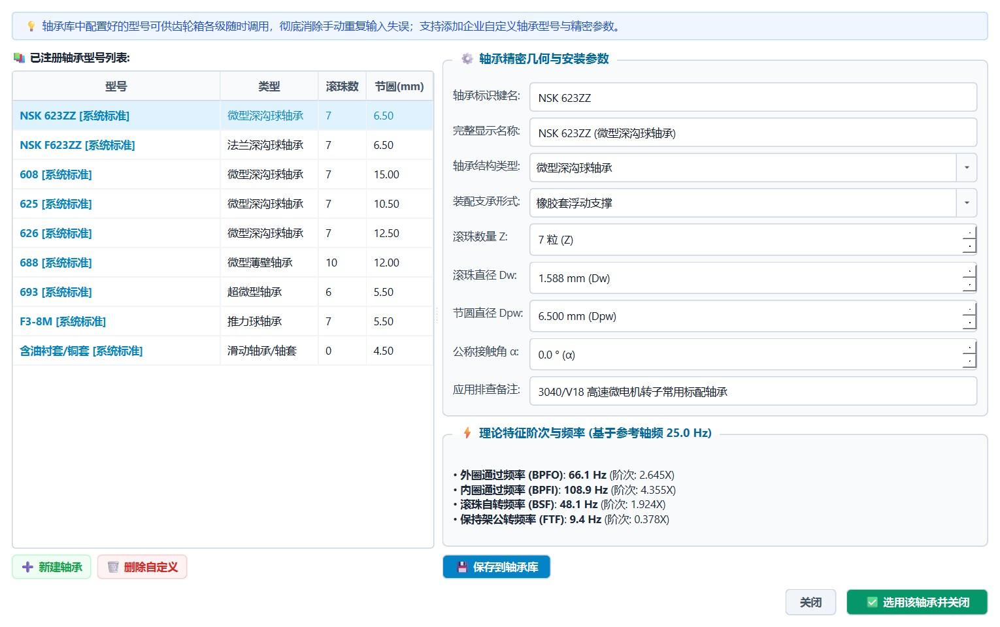
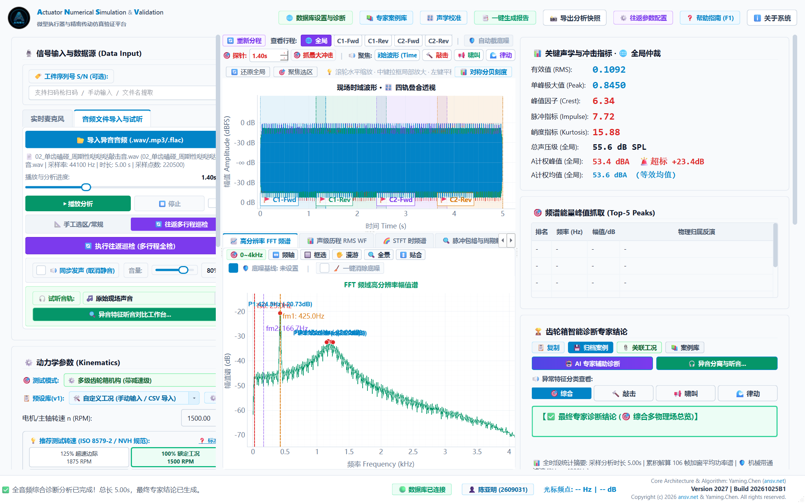
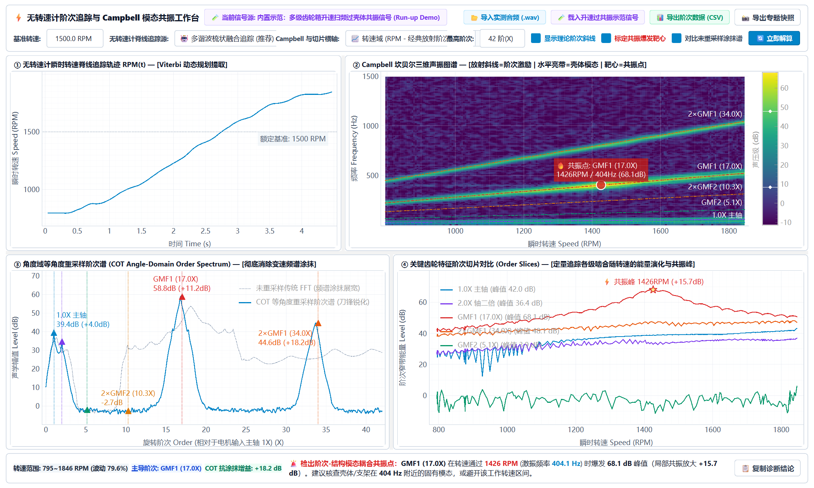

<div align="center">

<p align="right">
  <b>Language:</b>
  <a href="README.md"><b>🇬🇧 English</b></a> |
  <a href="README_CN.md">🇨🇳 简体中文</a>
</p>

# ⚙️ ANSV Gear-NVH 2027 | Industrial NVH Acoustic & Vibration Workstation
### Intelligent Diagnostic Workstation for Precision Reducers, Actuators, Industrial Gearboxes & Rotating Machinery (2027 Commercial Official Build | Build 20261025B1)

[](https://github.com/tonychen5577-tech/gear-nvh/releases/tag/v2027)
[-0284C7)](https://github.com/tonychen5577-tech/gear-nvh)
[](https://github.com/tonychen5577-tech/gear-nvh)
[](https://github.com/tonychen5577-tech/gear-nvh)
[-38BDF8)](https://gearnvh.ansv.net)

<p align="center">
  <b>Dedicated Hardware-Software Integrated Acoustic and Vibration Intelligent Diagnostic Workstation for Precision Reducers, Automotive Micro-Swing Actuators, Industrial Gearboxes, and Rotating Machinery</b>
</p>

[📥 Download 2027 Release](https://github.com/tonychen5577-tech/gear-nvh/releases/tag/v2027) • [✨ Key Features](#-key-features) • [🔬 Engineering Case Studies](#-real-world-engineering-case-studies) • [🔑 Licensing & Services](#-commercial-licensing--pricing) • [🎙️ Hardware & Testing Guide](#-recommended-hardware--testing-guidelines) • [📬 Technical Support (Contact Us)](#-technical-support--contact-channels-contact-us)

</div>

---

## 📖 System Overview

**ANSV Gear-NVH 2027** is an industrial-grade **acoustic anomaly and vibration frequency-domain intelligent diagnostic workstation** tailored for manufacturing floors, R&D laboratories, and end-of-line (EOL) quality inspection.

Traditional industrial inspections heavily depend on "subjective auditory judgment" by senior operators, which introduces **inconsistency, vulnerability to ambient background noise, lack of quantitative archiving, and ambiguous fault attribution between motor and gearbox suppliers**.

ANSV Gear-NVH integrates **high-precision dynamic signal acquisition, high-resolution kinematic frequency decomposition, micro-transient energy ratio analysis, and physical root-cause reasoning**:

Without complicated configuration, simply enter the input rotational speed and transmission tooth parameters. The system automatically performs kinematic inversion across the entire drive train to deduce shaft rotational frequencies, gear meshing frequencies (<code>f<sub>m</sub></code>), modulation sidebands, rolling bearing defect orders (BPFO, BPFI, BSF, FTF), and motor electromagnetic/commutation harmonics. It pinpoints the **exact failure stage and root cause**, delivering objective, quantitative, and deterministic scientific evidence for mechanical transmission quality control.

<p align="center">
  
  <br>
  <em>Figure 1: ANSV Gear-NVH 2027 Workstation Main Interface — Expert diagnostics of an 800 RPM multi-stage actuator under abnormal knocking conditions (featuring gear/bearing parameter inputs, motor stator/rotor pole configuration, time-domain transient highlighting, FFT order staking, and Top-5 peak energy attribution).</em>
</p>

---

## ✨ Key Features

### 1. Arbitrary-Stage Kinematic Modeling & Embedded Bearing Database
- **Scalable Stage Hierarchy**: Supports single-stage, two-stage, three-stage, and multi-stage cascaded transmission mechanisms with dynamic addition and removal of stages;
- **Multi-Topology Support**: Natively accommodates **spur gears, helical gears, planetary gearboxes, worm-and-gear reducers, and step-up overdrive gearboxes**;
- **Full Drivetrain Bearing Library & Order Inversion**: Assign standard rolling bearings to every shaft and motor rotor (built-in micro-bearing models including NSK 623ZZ, 681X, 692, 608, with custom parameter expansion). Automatically calculates four primary bearing defect orders: **Ball Pass Frequency Outer (BPFO), Ball Pass Frequency Inner (BPFI), Ball Spin Frequency (BSF), and Fundamental Train Frequency (FTF)**, automatically staked on the FFT spectrum;
- **Full Kinematic Frequency Inversion**: Dynamically resolves shaft speeds, individual stage gear ratios, total transmission ratio, and fundamental meshing frequencies (<code>f<sub>m</sub></code>) based on input RPM.

<p align="center">
  
  <br>
  <em>Figure 2: Built-in Precision Bearing Library Manager — Query and configure pitch diameters, ball counts, contact angles, and automatic BPFO/BPFI/BSF/FTF defect order multipliers.</em>
</p>

---

### 2. Reciprocating Multi-Stroke Adaptive Dynamic Inspection
- **Stroke Boundary Segmentation**: For oscillating mechanisms with finite angular travel (e.g., automotive HVAC damper actuators, seat lumbar adjusters, industrial valve positioners), the system automatically segments cycles into **Forward** and **Reverse** strokes using velocity zero-crossing and instantaneous energy envelope algorithms;
- **Impact Isolation & Steady-State Filtering**: Automatically discards end-point reversal deceleration impacts and mechanical hard stop collisions, isolating steady-state operating periods for pure meshing spectral analysis;
- **Drive-Side vs. Coast-Side Asymmetric Wear Assessment**: Compares positive and negative stroke energy spectra to identify directional wear on tooth profiles.

<p align="center">
  
  <br>
  <em>Figure 3: Reciprocating Multi-Stroke Dynamic Inspection — Automated forward/reverse stroke boundary segmentation and steady-state spectral kurtosis evaluation.</em>
</p>

---

### 3. Pure Motor Standalone Testing & Motor-Gearbox Decoupling
- **Decoupling Motor Harmonics from Gearbox Flaws**: Resolves disputes between motor suppliers and gearbox assemblers over noise accountability: **"Is the clicking caused by motor brush commutation or tooth runout?"**
- **Brushless Motor Slot & Pole Harmonics**: Computes cogging torque orders and phase-switching harmonics from stator slots and rotor poles;
- **Brushed DC Commutation Pulse Staking**: Accurately tracks brush-commutator friction pulses (<code>f<sub>c</sub> = RPM / 60 × segments</code>);
- **Instant Arbitration**: If peaks match commutation harmonics while gear mesh frequencies (<code>f<sub>m</sub></code>) remain flat, gear defects are 100% ruled out, preventing tens of thousands in unnecessary mold re-tooling costs.

<p align="center">
  
  <br>
  <em>Figure 4: Pure Motor Standalone Testing Mode — Stator/rotor pole slot harmonics, brush commutation pulse detection, and mechanical decoupling analysis.</em>
</p>

---

### 4. Acoustic-Insight 4-Track Sound Separation Engine
- Translates abstract spectrum plots into tangible, audible sound tracks. Uses specialized Non-Negative Matrix Factorization (NMF) and time-domain transient separation to decompose raw audio into 4 isolated channels:
  1. 🔴 **Transient Impacts Only (Knocking)**: Extracts isolated clicking and tapping sounds, eliminating steady background hum;
  2. 🟢 **Residual Background**: Preserves smooth tooth meshing hum without transient clicks, ideal for surface roughness assessment;
  3. 🔵 **Low-Frequency Rotation Rhythm**: Demodulates 1X/2X shaft eccentricities into low-frequency acoustic rhythms;
  4. ⚪ **Original Calibrated Signal**: High-fidelity calibrated raw audio with synchronized waveform and spectrum tracking.
- Supports side-by-side AB audio audition and batch WAV export for customer presentations.

---

### 5. ⚡ Tacholess Order Tracking & Campbell Modal Resonance Workbench
- **Encoder-Free Tacholess Ridge Tracking**: Built-in 45 Hz 4th-order zero-phase high-pass anti-impact filter, spectral continuum median whitening, and peak-minus-trough multi-harmonic comb salience with **Viterbi dynamic programming** to extract instantaneous shaft speed trajectories `RPM(t)` directly from acoustic or vibration signals without optical encoders;
- **COT Angle-Domain Order Spectrum**: Resamples non-stationary time waveforms at constant angular increments (dimensionless shaft Orders X), completely eliminating **spectral smearing** under run-up/coast-down sweeps or load fluctuations and delivering **+3 to +18.2 dB** peak sharpening gain over raw unresampled FFT;
- **Campbell 3D Diagram & Modal Resonance Bullseye**: Switch seamlessly between **Speed Domain (RPM)** and **Time Domain (s)**, overlay theoretical gear order rays (`1.0X`, `1×GMF`, `2×GMF`), and automatically pinpoint **🔥 Order-Structure Modal Resonance Crossings** where diagonal order rays intersect stationary housing natural frequency bands;
- **Characteristic Order Slices & Data Export**: Quantitatively tracks narrowband order energy vs. RPM/Time to separate pure forced gear excitation from structural casing resonance, featuring a built-in Run-up Resonance Demo generator, full CSV export, and high-res snapshot capture.

<p align="center">
  
  <br>
  <em>Figure 4b: Standalone [⚡ Order & Resonance Deep Analysis Workbench] — 2×2 synchronized diagnostic quad-view featuring Viterbi instantaneous RPM ridge tracking, Campbell diagram with resonance bullseye, COT razor-sharp order spectrum (+18.2 dB anti-smearing gain), and multi-stage order slices.</em>
</p>

---

### 6. CBR Expert Case Management Hub & Automated 8D Reporting
- **Case-Based Reasoning (CBR)**: Curates historical gearbox and actuator fault signatures, creating an institutional knowledge base;
- **Intelligent Spectral Matching**: Searches unseen spectra against historical databases to recall similar failure modes (e.g., uneven shrinkage in injection-molded gears, bearing tilt, backlash binding) and proven corrective actions;
- **Automated 8D Engineering Diagnostic Report**: One-click generation of customer-ready 8D reports containing time-domain metrics, kinematic evidence chains, FFT order charts, and tolerance tuning recommendations.

<p align="center">
  
  <br>
  <em>Figure 5: Expert Case Management Hub (CBR) — Empirical case archiving, multi-dimensional spectral retrieval, and intelligent similarity ranking.</em>
</p>

---

## 🔬 Real-World Engineering Case Studies

### Root-Cause Diagnosis of Periodic Knocking in a Two-Stage Actuator at 800 RPM
During quality audit of an automotive 2-stage precision actuator (Input: 800 RPM, Stage 1: 9T/36T, Stage 2: 10T/42T), an intermittent clicking noise occurred at approximately 3.33 Hz (one click every 0.3 seconds):

<p align="center">
  
  <br>
  <em>Figure 6: Real-World Test Spectrum at 800 RPM — Severe sideband modulation around Stage 2 meshing frequency fm2 (33.33 Hz) caused by a single chipped tooth on the intermediate pinion.</em>
</p>

- **Kinematic Inversion**: Input shaft `f1 = 13.33 Hz`. Stage 1 reduction ratio `i1 = 4.0`, yielding intermediate shaft frequency `f2 = 3.33 Hz` (exactly matching the 0.3s acoustic period). Stage 2 fundamental meshing frequency `fm2 = 3.33 × 10 = 33.33 Hz`;
- **Spectral Evidence**: Pronounced peak at 33.33 Hz with symmetric `±3.33 Hz` rotation sidebands. Spectral Kurtosis spiked to 7.82 (normal threshold: < 4.5);
- **Physical Verification**: Disassembly under optical microscope revealed a plastic molding ejection burr on a single tooth of the 10T pinion. Replacing the gear eliminated the noise completely, proving 100% diagnostic accuracy.

---

## 🔑 Commercial Licensing & Pricing

Flexible software licensing and engineering consultation packages tailored for manufacturers, suppliers, and R&D centers:

| Cooperation Tier | Pricing (USD / RMB) | Primary Positioning & Use Cases | Included Deliverables & Value Guarantee |
| :--- | :--- | :--- | :--- |
| ⚡ **Single Remote Anomaly Audit & 8D Report**<br>*(Recommended for urgent disputes)* | **$299** / case<br>*(¥ 2,000 fixed price)* | Urgent root-cause diagnosis and supplier liability arbitration (motor commutation vs. gear tooth flaw) to prevent costly mold re-tooling | • 24h rapid response turnaround<br>• Professional 8D engineering diagnostic report<br>• Clear fault attribution and tolerance adjustment guidelines |
| 🟢 **7-Day Full-Featured Free Evaluation** | **Free (7 Days)** | Technical feasibility evaluation and verification on your own prototype recordings | Full access to drivetrain kinematic inversion, bearing order tracking, and 4-track separation |
| 🟢 **R&D Engineering Professional Edition** | **$1,850** / yr (¥ 12,800)<br>or **$4,150** Lifetime (¥ 28,800) | For R&D labs and automotive technical centers conducting routine NVH testing, anomaly localization, and design optimization | Node-locked permanent/annual license, free minor OTA upgrades, and algorithmic technical support |
| 🟢 **Shopfloor EOL Quality Inspection Edition** | **$3,150** / station / yr (¥ 21,800)<br>or **$6,950** Lifetime (¥ 48,000) | For mass-production lines, EOL end-of-line testing, and pass/fail quality grading (Normal / Warning / Critical) | Direct industrial sensor acquisition, bidirectional cloud sync (custom PLC and test-bench integration support) |
| 🟣 **Turnkey Hardware & Software Bundle** | **$8,500 ~ $9,900** / set<br>*(¥ 58,000 ~ 68,000)* | Turnkey package for manufacturers seeking out-of-the-box deployment without external hardware debugging | Commercial software license + recommended measurement-grade microphone/accelerometer + pre-configured industrial IPC |

---

### Rapid Activation Process

```
Step 1: Download, extract, and launch Gear_Acoustic_App.exe
   │
   ▼
Step 2: Click [About System] in the top toolbar or click [Copy Machine Code] on first launch (e.g., GA-98F2-3A1B-2026)
   │
   ▼
Step 3: Contact our team via WhatsApp, WeChat, or Email to receive your 7-day trial or commercial license key
   │
   ▼
Step 4: Supports instant 3-second cloud remote push activation (auto-unlocks with a pop-up without restarting) or manual license key activation (securely persisted in %LOCALAPPDATA%\GearAcoustic\license.lic across upgrades)!
```

---

## 🎙️ Recommended Hardware & Testing Guidelines

To ensure optimal signal-to-noise ratio in industrial environments, the following hardware is recommended:

| Hardware Type | Recommended Models | Key Advantages & Connection | Recommended Use Case |
| :--- | :--- | :--- | :--- |
| **Measurement-Grade Microphone** | **miniDSP UMIK-1 / UMIK-2** <br>or **Dayton Audio UMM-6** | USB direct connect, factory calibration file included, flat frequency response (20 Hz ~ 20 kHz), plug-and-play | R&D laboratory acoustic testing, offline sample auditing |
| **Industrial Sound Level Meter** | Sound level meter with Line-Out <br>+ High-SNR USB Audio Interface | Wide dynamic range, compliant with IEC 61672, industrial shielding | High-noise factory floor auditing, ambient noise threshold arbitration |
| **High-Frequency Accelerometer** | IEPE Piezoelectric Accelerometer <br>+ USB Dynamic Signal Analyzer | Magnetic attachment to gearbox casing, impervious to airborne background noise | Direct structural vibration monitoring, early tooth micro-defect detection |

### Measurement Best Practices:
1. **Microphone Distance**: Position the microphone **30 mm to 100 mm** from the gearbox meshing zone casing, avoiding direct airflow;
2. **Ambient Noise Shielding**: In high-noise workshops, use a portable acoustic enclosure around the test article or switch to a contact accelerometer;
3. **Steady-State Sampling**: Acquire **3 to 10 seconds** of data after the drive motor reaches steady rotational speed to capture sufficient rotation cycles.

---

## 📬 Technical Support & Contact Channels (Contact Us)

For technical support, custom project consultations, commercial licensing, or engineering partnerships, reach our engineering team via:

<div align="center">

| 1. 🌐 WhatsApp (International) | 2. 💬 Dedicated Engineer WeChat | 3. 📢 Official WeChat Channel |
| :---: | :---: | :---: |
|  |  |  |
| **WhatsApp**: `ansv_net` | **WeChat ID**: `ansv-net` | **Account**: `ANSV微型执行器` |
| Direct global technical support for overseas & APAC partners | 1-on-1 technical consultation, licensing & project collaboration | Hardcore NVH engineering case reviews & technical articles |

</div>

- **Official Website**: [https://ansv.net](https://ansv.net)
- **GitHub Repository**: [tonychen5577-tech/gear-nvh](https://github.com/tonychen5577-tech/gear-nvh)
- **Technical Support & Business Email**: [support@ansv.net](mailto:support@ansv.net)

---

<div align="center">
  <sub>Copyright © 2026 ANSV Transmissions & Micro-Actuators Lab (ansv.net). All rights reserved. | Industrial Metrology · Numerical Simulation · Engineering Excellence</sub>
</div>